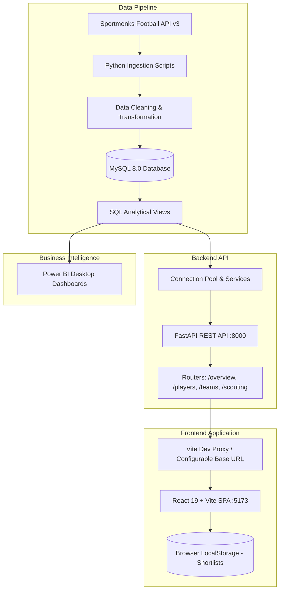

# ⚽ ScoutIQ — Football Intelligence & Recruitment Platform

**An end-to-end full-stack football analytics and scouting platform for player recruitment, performance benchmarking, and team intelligence.**

ScoutIQ transforms raw football match data into high-resolution scouting insights. It pairs an automated Python ETL pipeline and MySQL database with an asynchronous **FastAPI REST API**, a high-performance **React + Vite single-page application**, and analytical **Power BI dashboards**.

---

## 📌 Project Overview

Recruitment in modern football requires evaluating multi-dimensional contributions beyond raw goal counts. Scouts and analysts require access to playing-time context, per-90 normalized statistics, shooting and passing efficiency, defensive duel rates, and squad performance profiles.

ScoutIQ addresses this by integrating football data ingestion via the Sportmonks Football API, normalized relational storage in MySQL, analytical SQL views, a high-performance REST API, and two distinct presentation layers:
1. **Interactive Full-Stack Web Application:** Powered by FastAPI, React 19, Recharts, and a responsive Retro-Pixel design system.
2. **Business Intelligence Suite:** Interactive Power BI dashboards connected directly to MySQL analytical views.

### Project Scope & Dataset
- **Competition:** Danish Superliga
- **Season:** 2025/2026
- **Matches processed:** 192 matches
- **Teams:** 12 clubs
- **Unique Players:** 412 unique players
- **Player match statistics:** 154,739 records across 69 distinct statistical types

---

## 🎯 Key Application Features

### 1. 📊 Executive Overview Dashboard
- Executive season-level KPIs: Total unique players, active clubs, total goals, total assists, and league-wide average player rating.
- Dynamic Recharts visualizations for top goalscorers, top assist creators, and club goal differential (goals scored vs. conceded).
- Real-time API & database connectivity badge.

### 2. 🔍 Player Directory & Comprehensive Profiles
- Paginated player database with real-time text search, club filtering, minimum minutes played threshold, and minimum rating sliders.
- Multi-column sorting by rating, minutes played, goals per 90, and assists per 90.
- Deep-dive player profile modal/pages displaying:
  - Season counting stats (appearances, minutes, goals, assists, shots, tackles, interceptions).
  - Tactical percentages (shooting accuracy, pass completion %, tackle win %, aerial duel %).
  - Normalized per-90 offensive and defensive radar/bar metrics.

### 3. ⚔️ Head-to-Head Player Comparison
- Dual searchable player selectors with duplicate prevention.
- Side-by-side metric matrix displaying minutes, appearances, ratings, and normalized per-90 indicators.
- Automatic categorical leader calculation highlighting superior performance across offensive, playmaking, and defensive attributes.

### 4. 🛡️ Team Standings & Club Analytics
- Official Danish Superliga aggregated standings (position, matches played, wins, draws, losses, goals for/against, goal difference, points, and average possession).
- Club-specific squad rosters with squad size, squad average match rating, and team top performers.

### 5. 🏆 Scouting Rankings
- Specialized ranking leaderboards filtered by eligible playing-time thresholds across four analytical categories:
  - **Clinical Finishers:** Ranked by goals scored per 90 minutes.
  - **Creative Playmakers:** Ranked by combined shot-creation actions (key passes + assists per 90).
  - **Defensive Disruptors:** Ranked by combined ball-winning actions (tackles + interceptions per 90).
  - **Elite Consistency:** Highest average match rating (minimum 900 minutes played).

### 6. ⭐ Recruitment Shortlist (Browser Persisted)
- Bookmark any player into a dedicated recruitment shortlist with one click.
- Stored reliably in browser `localStorage` across user sessions.
- Summary analytics bar showing shortlist size, average shortlisted player rating, and total minutes.
- Quick player profile inspection and instant candidate removal.

---

## 🏗️ System Architecture



---

## 🛠️ Technology Stack

| Layer | Technologies | Purpose |
|---|---|---|
| **Frontend** | React 19, Vite 8, Recharts, Lucide Icons, CSS3 | Single-Page Application, interactive charts, retro-pixel design |
| **Backend API** | FastAPI 0.110+, Uvicorn, Pydantic v2 | High-performance asynchronous RESTful API & data validation |
| **Database** | MySQL Server 8.0, `mysql-connector-python` | Relational storage, connection pooling, analytical views |
| **Data Pipeline** | Python 3.10+, Requests, python-dotenv | Sportmonks API ingestion, cleansing, and automated loading |
| **Business Intelligence** | Microsoft Power BI Desktop, DAX | Multi-page executive and scouting dashboards (`.pbix`) |
| **Testing & Quality** | Python Requests, Oxlint, Vite Build | Integration test suite, static linting, production bundling |

---

## 📋 Prerequisites

Before running ScoutIQ locally, ensure you have the following installed:
- **Python:** Version `3.10` or higher (verified on Python 3.13)
- **Node.js:** Version `18.0.0` or higher (with `npm`)
- **MySQL Server:** Version `8.0` or higher
- **Power BI Desktop:** (Optional) To view and edit `ScoutIQ_Football_Analytics.pbix`

---

## 🚀 Local Setup & Installation

### Option A: One-Command Launch (Windows)

ScoutIQ includes automated launcher scripts that verify dependencies, activate `.venv`, install missing frontend packages, launch both servers in dedicated consoles, and open the web browser:

```powershell
# In PowerShell:
.\run.ps1
# or
.\run.bat
```

---

### Option B: Step-by-Step Manual Setup

#### 1. Clone the Repository
```bash
git clone https://github.com/gowtham079/Scout-IQ.git
cd Scout-IQ
```

#### 2. Configure Python Virtual Environment & Dependencies
```bash
# Create virtual environment
python -m venv .venv

# Activate virtual environment
# Windows (PowerShell):
.\.venv\Scripts\Activate.ps1
# Windows (CMD):
.\.venv\Scripts\activate.bat
# Linux / macOS:
source .venv/bin/activate

# Install backend and pipeline dependencies
pip install -r requirements.txt
```

#### 3. Configure Environment Variables
Copy the template configuration file to `.env`:
```bash
# Windows:
copy .env.example .env
# Linux / macOS:
cp .env.example .env
```
Open `.env` and configure your local MySQL database credentials:
```ini
MYSQL_HOST=127.0.0.1
MYSQL_PORT=3306
MYSQL_USER=your_mysql_username
MYSQL_PASSWORD=your_mysql_password
MYSQL_DATABASE=scoutiq
CORS_ORIGINS=http://localhost:3000,http://localhost:5173,http://127.0.0.1:3000,http://127.0.0.1:5173
```

#### 4. Initialize Database & Views
Ensure your MySQL server is running and the database tables and analytical views are created:
```bash
# Verify connection
python test_mysql.py

# Rebuild analytical views if needed
python src/analytics/build_views.py
```

#### 5. Start the FastAPI Backend
```bash
uvicorn backend.app.main:app --host 127.0.0.1 --port 8000 --reload
```
The REST API will be available at `http://127.0.0.1:8000`.

#### 6. Start the React Frontend
In a new terminal window:
```bash
cd frontend
npm install
npm run dev
```
The frontend interface will open at `http://localhost:5173`.

> **Note on Frontend API Routing:** During local development, `frontend/vite.config.js` proxies all requests to `/api` directly to `http://127.0.0.1:8000`. In production, the client supports configuring `VITE_API_BASE_URL` to target any hosted API domain.

---

## 📡 REST API Documentation

FastAPI automatically generates interactive OpenAPI documentation. With the backend running, visit:
- **Swagger UI:** [http://127.0.0.1:8000/docs](http://127.0.0.1:8000/docs)
- **ReDoc:** [http://127.0.0.1:8000/redoc](http://127.0.0.1:8000/redoc)

### Implemented Endpoints

| Method | Endpoint | Description |
|---|---|---|
| `GET` | `/api/health` | Health check verifying API status and MySQL connection pool health. |
| `GET` | `/api/overview` | Executive KPIs, season goal totals, top scorers/assisters, and goal distributions. |
| `GET` | `/api/players` | Filterable player scouting directory with pagination, search, and sorting. |
| `GET` | `/api/players/{player_id}` | Detailed player profile, season totals, percentages, and per-90 metrics. |
| `GET` | `/api/teams` | League standings with points, goal differential, and possession rates. |
| `GET` | `/api/teams/{team_id}` | Club squad breakdown, average squad rating, and squad statistical leaders. |
| `GET` | `/api/scouting/compare` | Head-to-head comparison of two players across per-90 stats with winner flags. |
| `GET` | `/api/scouting/top-performers` | Ranked leaderboards across 4 distinct scouting categories. |

---

## ⚙️ Environment Variables Reference

| Variable | Applicable Layer | Description | Default / Example |
|---|---|---|---|
| `MYSQL_HOST` | Backend & ETL | MySQL server hostname or IP address | `127.0.0.1` |
| `MYSQL_PORT` | Backend & ETL | MySQL server listening port | `3306` |
| `MYSQL_USER` | Backend & ETL | Database user account | `root` or `scoutiq_user` |
| `MYSQL_PASSWORD` | Backend & ETL | Database user password | *User configured* |
| `MYSQL_DATABASE` | Backend & ETL | Target database schema name | `scoutiq` |
| `CORS_ORIGINS` | Backend API | Comma-separated list of allowed frontend origins | `http://localhost:5173,...` |
| `SPORTMONKS_API_TOKEN` | Ingestion Pipeline | API key for Sportmonks v3 (only for data ingestion) | `your_token_here` |
| `VITE_API_BASE_URL` | Frontend Build | Optional backend URL for separate hosting | `/api` |

---

## 🧪 Testing & Production Build

### Run Backend Integration Tests
Execute the automated integration test suite against the running API:
```bash
python tests/test_api_suite.py
```
This suite verifies database connectivity, schema responses, pagination boundaries, and scouting endpoints.

### Frontend Production Build & Linting
Validate the frontend code and produce the optimized static bundle:
```bash
cd frontend
# Run static analysis
npm run lint

# Build production bundle
npm run build
```
The compiled assets will be output to `frontend/dist/`.

### Production Deployment Architecture
ScoutIQ is architected for decoupled cloud deployment:
1. **Database:** Hosted on any managed MySQL service (e.g., AWS RDS, PlanetScale, DigitalOcean).
2. **Backend:** Deployed to any ASGI/PaaS host (Render, Railway, Heroku) using the root `Procfile`:
   ```ini
   web: uvicorn backend.app.main:app --host 0.0.0.0 --port ${PORT:-8000}
   ```
3. **Frontend:** Deployed as a static SPA (Vercel, Netlify, Cloudflare Pages) with `VITE_API_BASE_URL` pointed to the hosted backend domain.

---

## 📊 Power BI Dashboards

In addition to the web application, ScoutIQ includes an enterprise Power BI report (`ScoutIQ_Football_Analytics.pbix`) connected directly to MySQL views.

### Dashboard Pages
1. **ScoutIQ Overview:** Executive summaries, league goals, assists, player ratings, and goal distribution charts.
2. **Player Scouting:** Scatter plots, playing-time filters, passing accuracy, duel-win rates, and per-90 metrics.
3. **Team Performance:** Points table, goals scored/conceded, home/away splits, and possession analysis.

### Dashboard Screenshots
Screenshots are archived in the [`Dashboard Images`](./Dashboard%20Images/) directory:

- **Overview:**
  
- **Player Scouting:**
  
- **Team Performance:**
  

---

## 🗄️ Database Schema & Analytical Views

ScoutIQ stores normalized football data structured across fixtures, teams, players, lineups, and match events. Reusable SQL analytical views calculate metrics dynamically:

| SQL File | View Name | Purpose |
|---|---|---|
| `01_player_match_summary.sql` | `vw_player_match_summary` | Match-by-match player statistics and ratings |
| `02_player_season_performance.sql` | `vw_player_season_performance` | Aggregated season totals (minutes, appearances, goals, assists) |
| `03_player_per90_metrics.sql` | `vw_player_per90_metrics` | Normalized per-90 metrics (goals, assists, key passes, tackles) |
| `04_team_season_performance.sql` | `vw_team_season_performance` | Club standings, points, goal differential, and possession |
| `05_player_scouting_features.sql` | `vw_player_scouting_features` | Consolidated scouting profile with efficiency percentages |
| `06_analytics_validation.sql` | *N/A (Script)* | Data quality checks (duplicate checks, negative values, anomalies) |

---

## 📁 Repository Structure

```text
ScoutIQ/
├── backend/                        # FastAPI REST API Application
│   └── app/
│       ├── routers/                # API Endpoints (overview, players, teams, scouting)
│       ├── schemas/                # Pydantic request and response schemas
│       ├── services/               # SQL queries and business logic
│       ├── database.py             # MySQL connection pooling and health checks
│       └── main.py                 # FastAPI application factory and CORS middleware
│
├── frontend/                       # React 19 + Vite Single-Page Application
│   ├── public/                     # Static assets (favicons, SVG icons)
│   ├── src/
│   │   ├── api/client.js           # Centralized API client with configurable base URL
│   │   ├── components/             # Reusable UI components (Navbar, Layout, Spinner)
│   │   ├── context/                # React Context (ShortlistContext with localStorage)
│   │   ├── pages/                  # Route views (Overview, Players, Compare, Teams, Rankings, Shortlist)
│   │   ├── index.css               # Retro-Pixel CSS design tokens and base styles
│   │   └── main.jsx                # Application entry point
│   ├── package.json                # Frontend dependencies and scripts
│   └── vite.config.js              # Vite server and /api proxy configuration
│
├── sql/analytics/                  # Analytical SQL views and data validation scripts
├── src/                            # Python data pipeline (ingestion, cleaning, transformation, loading)
├── tests/                          # Automated backend integration test suite
├── docs/                           # Technical documentation (schemas, data dictionaries, profiles)
├── Dashboard Images/               # Power BI dashboard screenshots
├── ScoutIQ_Football_Analytics.pbix # Power BI analytics workbook
├── .env.example                    # Template environment variables
├── .gitignore                      # Git exclusion rules
├── Procfile                        # Production ASGI server startup command
├── requirements.txt                # Python backend and pipeline dependencies
├── run.bat / run.ps1 / start.bat   # Windows one-command application launchers
├── test_api.py / test_mysql.py     # Database and API sanity verification scripts
└── README.md                       # Master project documentation
```

---

## 🔍 Limitations & Context

- **Competition Scope:** The current dataset covers the 2025/2026 Danish Superliga season.
- **Data Source:** Statistics reflect data provided by the Sportmonks Football API v3.
- **Expected Goals (xG):** Advanced shot-level xG models were unavailable under the basic API subscription tier.
- **Contextual Scouting:** Player comparisons should account for tactical team system, role variations, and game state.

---

## 👨‍💻 Author

**Gowtham S**
MCA Student | Aspiring Data Analyst & Full-Stack Developer

**Core Skills Demonstrated:** Full-Stack Development (FastAPI, React 19, Vite), SQL Analytics, Database Modeling (MySQL), REST API Architecture, ETL Pipelines, Data Cleansing, Data Visualization (Recharts, Power BI).
